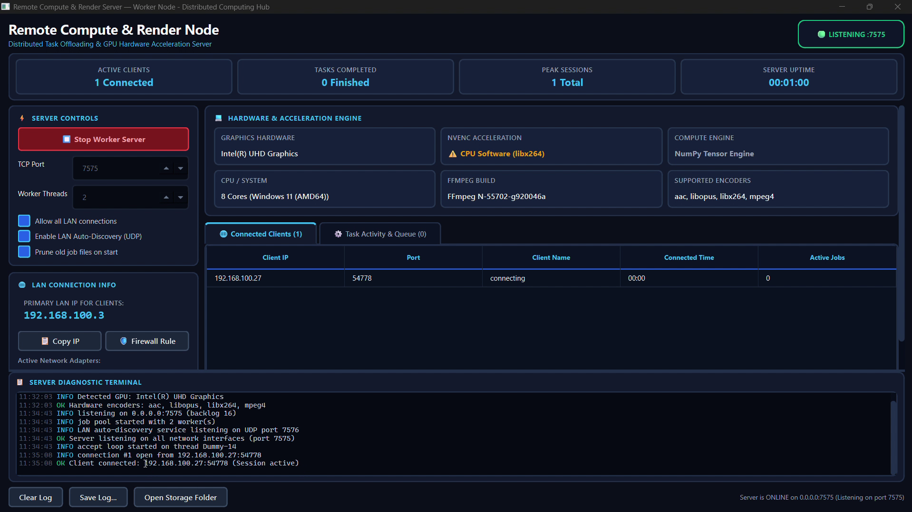
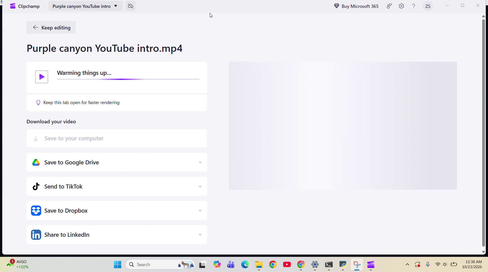
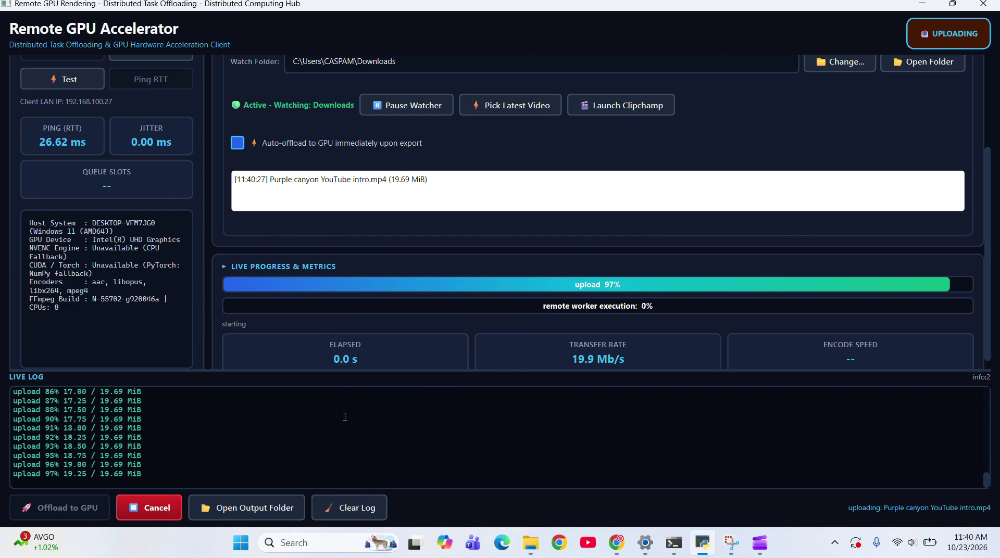
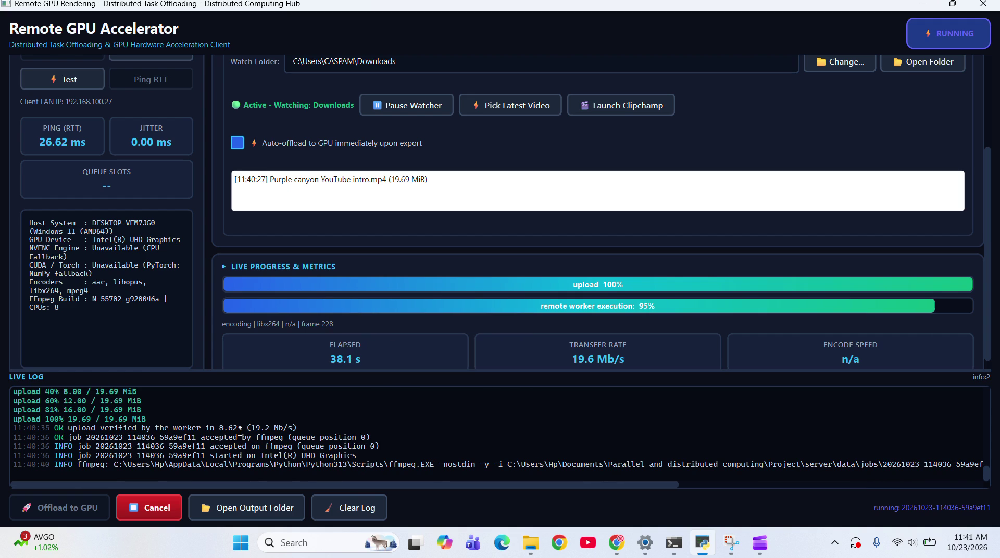
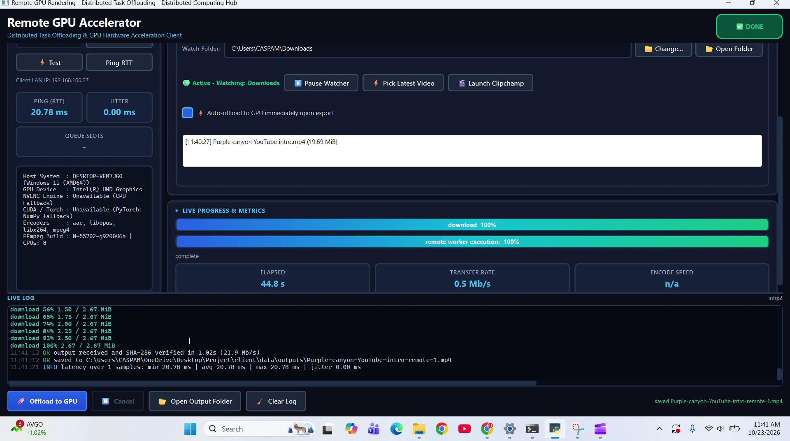
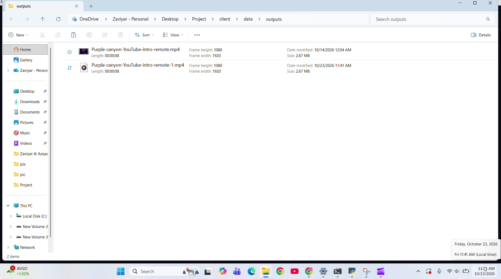

# Distributed Task Offloading and Remote Rendering

Offload heavy video transcoding and numeric compute workloads from a lightweight client laptop to a remote worker node over a high-speed local network (LAN / Wi-Fi), featuring a modern dark-themed PyQt6 interface, asynchronous dual progress streaming, Clipchamp watch folder automation, and end-to-end SHA-256 checksum verification.

```
   CLIENT LAPTOP (Lightweight Node)                       REMOTE WORKER (Compute Node)
   +------------------------------------+                +------------------------------------+
   |  PyQt6 GUI Client                  |                |  server/app.py (Daemon)            |
   |    Folder Watcher (Clipchamp)      |   length-      |    accept loop (independent)       |
   |    worker on a QThread             |  prefixed TCP  |    session thread + writer thread  |
   |    upload -> job -> stream fetch   |  frames, 7575  |    job pool -> FFmpeg / PyTorch    |
   +------------------------------------+                +------------------------------------+
                     ▲                                                      │
                     └────────── Real-time Progress & Checksums ────────────┘
```

---

## 🎬 Video Demonstrations & Real-World Walkthrough

Two comprehensive, end-to-end screen recordings captured from a live multi-machine session across a local network (`192.168.100.x`):

| Demonstration Recording | Target Machine | Duration | Key Demonstration Highlights |
|---|---|---|---|
| **[Client-side Clipchamp & Remote Offload](screenrecordigs/Client-side-edited-and-render-video-of-clip-champ-remote.mp4)** | Client Laptop (`192.168.100.27`) | 2 min 34s | Video editing in Clipchamp, automated watch folder detection, LAN upload (19.6 Mb/s), live dual progress bars, 86.4% compression, SHA-256 verification |
| **[Server-side Daemon & Execution Node](screenrecordigs/server%20side.mp4)** | Worker Desktop (`192.168.100.3:7575`) | 51 sec | GUI worker daemon listening, live client tracking, 2-worker thread pool, FFmpeg transcode execution, job storage artifact inspection |

---

### Video 1 Breakdown: Client-Side Automated Offload Workflow
*File: `screenrecordigs/Client-side-edited-and-render-video-of-clip-champ-remote.mp4`*

```
[ Clipchamp Project Export ] ──► [ Background Watcher ] ──► [ 19.6 Mb/s Upload ] ──► [ Remote Render ] ──► [ Verified Download ]
     (19.69 MiB Draft)            (Instant Detection)          (SHA-256 Verified)         (FFmpeg Transcode)       (2.67 MiB Output: -86.4%)
```

1. **0:00 – 0:15 (Initialization & Telemetry)**:
   * Client launches with background **Folder Watcher** monitoring `C:\Users\CASPAM\Downloads`.
   * Probes network latency (**26.62 ms**, 0.00 ms jitter) to worker `192.168.100.3:7575`.
   * Worker capabilities negotiated and displayed: `Intel(R) UHD Graphics`, 8 CPU cores, FFmpeg build capabilities.
2. **0:15 – 0:55 (Clipchamp Video Editing & Export)**:
   * The user opens **Microsoft Clipchamp**, opens project *"Purple canyon YouTube intro"*, and clicks **Export**.
   * Clipchamp completes the draft render and downloads `Purple canyon YouTube intro.mp4` (**19.69 MiB**) into the Downloads directory.
3. **0:55 – 1:15 (Automated Watch Folder Trigger)**:
   * The Folder Watcher detects write completion and file unlocking (`[11:40:27] Purple canyon YouTube intro.mp4 (19.69 MiB)`).
   * Because **"⚡ Auto-offload to GPU immediately upon export"** is active, the video is staged and transmitted immediately over the LAN socket without requiring manual file picking.
4. **1:15 – 1:55 (Streaming Upload & Remote Worker Execution)**:
   * High-throughput upload streams at **19.6 Mb/s**; the worker verifies the binary SHA-256 digest in **8.62s**.
   * Remote worker executes the transcoding engine; live percentage updates stream back asynchronously to the client (`remote worker execution: 2% ➔ 95% ➔ 100%`).
5. **1:55 – 2:34 (Verified Download & Size Optimization)**:
   * Rendered video streams back at **21.9 Mb/s** and completes local SHA-256 integrity verification in **1.02s**.
   * **Compression Ratio**: Draft input reduced from **19.69 MiB down to 2.67 MiB** (**86.4% bandwidth & storage savings**).
   * User opens local outputs folder (`outputs/Purple-canyon-YouTube-intro-remote-1.mp4`) confirming the 1080p master video is ready for playback.

---

### Video 2 Breakdown: Server-Side Worker Node Operation
*File: `screenrecordigs/server side.mp4`*

1. **0:00 – 0:20 (Daemon Readiness & Discovery)**:
   * Server Node GUI active and listening on `0.0.0.0:7575` (Primary LAN IP: `192.168.100.3`).
   * Zero-config UDP LAN auto-discovery service listening on port `7576`.
   * Hardware acceleration probes detect graphics hardware, 8 CPU cores, and supported encoders (`aac, libopus, libx264, mpeg4`).
2. **0:20 – 0:35 (Session Management & Client Tracking)**:
   * Real-time client registry shows active connection from `192.168.100.27:54778`.
   * Accepts job `20261023-114036-59a9ef11`, allocating worker thread from bounded pool (2 workers).
   * Asynchronously streams frame-by-frame progress back to the laptop client.
3. **0:35 – 0:51 (Job Storage & Artifact Inspection)**:
   * Operator clicks **"Open Storage Folder"** to inspect server working directory `server/data/jobs/20261023-114036-59a9ef11/output/`.
   * Confirms `Purple-canyon-YouTube-intro-remote.mp4` (2,740 KB / 2.67 MB) generated cleanly before transmission.

---

## 📸 Screenshots & Visual Walkthrough

Captured directly from the running applications during the live screen recording session:

### 1. Server Node Daemon Initialized & Tracking Client
Worker daemon listening on `192.168.100.3:7575` with active client tracking (`192.168.100.27:54778`), hardware acceleration telemetry, and UDP auto-discovery.



### 2. Microsoft Clipchamp Video Editing & Export Workflow
User editing and exporting the draft video in Clipchamp on the client laptop, saving the raw export to the local Downloads directory.



### 3. Connected Client, Capabilities & Watch Folder Pipeline
PyQt6 client connected over LAN, displaying real-time RTT latency (26.62 ms), remote hardware capabilities, and active watch folder automation.



### 4. Active Offloading & Dual Progress Streaming
Streaming transmission and remote worker execution running concurrently, displaying live 19.6 Mb/s transfer rate, elapsed time, and log stream.



### 5. Verified Task Completion & 86.4% Size Optimization
Job marked Done with 100% download received, SHA-256 verified in 1.02s, compressing the 19.69 MiB draft to 2.67 MiB.



### 6. Local Output Verification in Windows File Explorer
Local outputs directory opened to verify the rendered 1080p MP4 file (`outputs/Purple-canyon-YouTube-intro-remote-1.mp4`) ready for playback.



*(See [`screenshots/README.md`](screenshots/README.md) for full gallery details).*

---

## 🚀 Quick Start (Zero-CMD Desktop Applications)

For a friendly, non-technical experience across two desktop computers on the same LAN, use the desktop launchers without needing to type Shell/CMD commands:

### 1-Click Desktop Launchers:
* **Unified Control Hub**: Double-click **`Launch_Hub.vbs`** (or `Launch_Hub.bat` / `python desktop_hub.py`)
* **GPU Worker Server**: Double-click **`Launch_Server.vbs`** (or `Launch_Server.bat` / `python server/app.py`)
* **Client Task Offloader**: Double-click **`Launch_Client.vbs`** (or `Launch_Client.bat` / `python client/app.py`)
* **Desktop Shortcuts**: Click **"📌 Create Desktop Shortcuts"** in the Hub (or run `python tools/install_shortcuts.py`) to place shortcuts on your Windows Desktop.

### Connecting in 3 Clicks over LAN:
1. **On Server**: Open Server Node, click **`▶ Start Worker Server`**. The app displays your primary LAN IP with a **`📋 Copy IP`** button.
2. **On Client**: Open Client Controller, click **`🔍 Scan`**. The app auto-discovers the server on your LAN via UDP beacon.
3. Click **`Connect`** — hardware capabilities are negotiated, and you can submit video transcoding or tensor compute jobs immediately!

*(For non-technical users, see the complete [Desktop User Guide](DESKTOP_USER_GUIDE.md)).*

### Classic CLI Mode (Optional for Headless Servers):
On the **worker**:
```powershell
python server\daemon.py --host 0.0.0.0 --port 7575
```
On the **client**:
```powershell
python client\app.py --host 192.168.1.1 --port 7575
```

---

## ⚙️ Core Architecture & Features

* **Capability Negotiation**: Handshake protocol queries remote GPU/CPU capabilities (NVENC, CUDA, PyTorch, FFmpeg encoders) before job creation; unoffered encoders are disabled in the UI.
* **Watch Folder Automation (`client/watcher.py`)**: Continuously monitors export directories (Clipchamp/Premiere/CapCut) with file snapshot tracking (`(size, mtime)`), waiting for file lock release before triggering instant auto-offload.
* **Zero-Config LAN Discovery (`common/discovery.py`)**: UDP broadcast discovery on port 7576 with active OS kernel routing detection, automatically filtering out virtual network adapters (VMware, WSL, VirtualBox).
* **Streaming Protocol & Integrity**: Length-prefixed framing over TCP port 7575 with end-to-end SHA-256 chunk hashing and atomic `.part` staging.
* **Bounded Job Pool**: Fixed worker concurrency caps server load; job cancellation is honored both while queued and during active execution.
* **Monotonic Dual Progress**: Rate-limited percentage updates tracking both network transfer and remote worker FFmpeg transcoding.
* **Dual Compute Engines**: Video transcoding via FFmpeg (NVENC hardware acceleration with CPU fallback) and numeric tensor operations via PyTorch CUDA / NumPy.

---

## 📂 Repository Layout

```
common/         protocol framing, message types, validation, checksums, discovery
server/         daemon, accept loop, session state machine, queue + pool, storage,
                capability probing, FFmpeg and PyTorch compute engines
client/         PyQt6 GUI, Qt worker wrapper, watch folder automation, transport
tools/          benchmark harness, network probe, sample media generator, network setup
tests/          190 unit and end-to-end integration tests (100% passing)
docs/           PRD, architecture, protocol specification, network setup, testing
screenrecordigs/ live screen recordings demonstrating client and server workflows
screenshots/    high-resolution visual walkthrough images captured from live sessions
benchmarks/     measured results (RESULTS.md) and raw JSON metrics
```

---

## 💻 Commands Reference

| Purpose | Command |
|---|---|
| Run Desktop Hub | `python desktop_hub.py` |
| Run GUI Worker Node | `python server\app.py` |
| Run GUI Client | `python client\app.py` |
| Run Headless Worker | `python server\daemon.py --host 0.0.0.0 --workers 2` |
| Run Test Suite | `python -m pytest tests -q` (190 tests) |
| Probe Network Link | `python tools\probe_network.py --host 192.168.100.3 --port 7600` |
| Automated Benchmark | `python tools\bench.py --host 192.168.100.3 --all --repeat 3` |
| Create Desktop Shortcuts | `python tools\install_shortcuts.py` |

---

## 📊 Measured Benchmark Summary

| Evaluation Setup | Input Video | Output Video | Transfer Rate | Total Time | Size Reduction | Verification |
|---|---|---|---|---|---|---|
| **Live Wi-Fi LAN Demo** (`192.168.100.x`) | 19.69 MiB (1080p Clipchamp) | 2.67 MiB (1080p Master) | 19.6 – 21.9 Mb/s | 44.8 s | **86.4%** | SHA-256 Match |
| **Local Loopback CPU Baseline** | Synthetic 4K Test Clip | Transcoded 1080p | Loopback | ~14.3 s | Varies | SHA-256 Match |

*(See [`REPORT.md`](REPORT.md) and [`benchmarks/RESULTS.md`](benchmarks/RESULTS.md) for full technical analysis and evaluation methodology).*

---

## 📖 Documentation Index

| Document | Description |
|---|---|
| [`DESKTOP_USER_GUIDE.md`](DESKTOP_USER_GUIDE.md) | Beginner-friendly desktop setup guide matching the live screen recordings |
| [`REPORT.md`](REPORT.md) | Comprehensive engineering report, design decisions, and empirical evaluation |
| [`docs/PRD.md`](docs/PRD.md) | Product Requirements Document: functional/non-functional requirements |
| [`docs/ARCHITECTURE.md`](docs/ARCHITECTURE.md) | Threading architecture, watch folder lifecycle, and subsystem interactions |
| [`docs/PROTOCOL.md`](docs/PROTOCOL.md) | Framing specification, binary packet structures, and handshake sequence |
| [`docs/NETWORK.md`](docs/NETWORK.md) | Addressing, firewall rules, router troubleshooting, and latency optimization |
| [`docs/TESTING.md`](docs/TESTING.md) | Test coverage breakdown across all 190 test suites |
