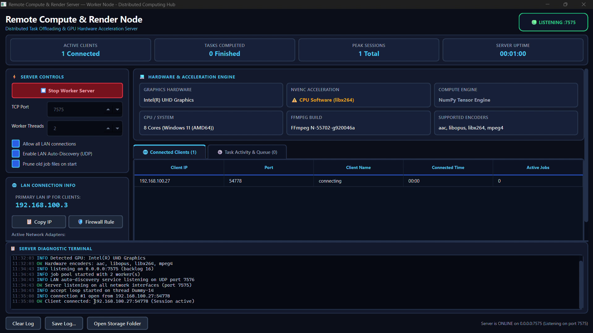
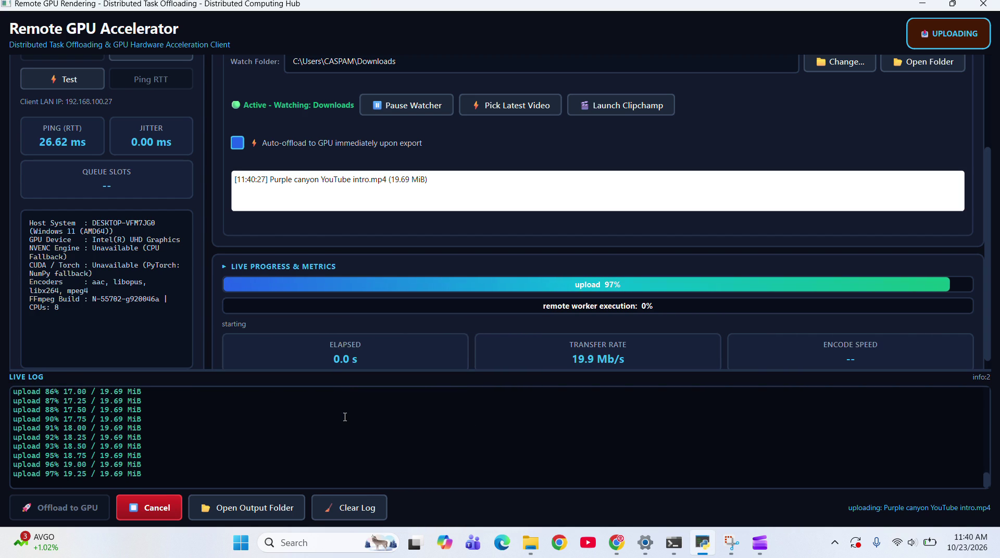
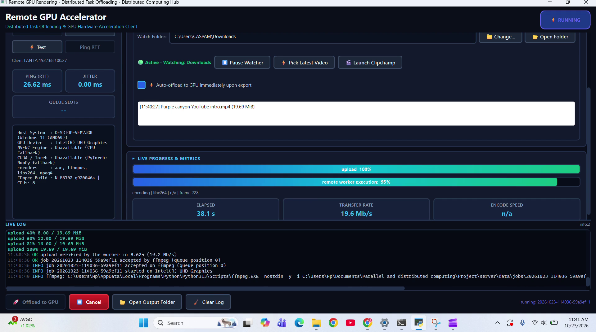
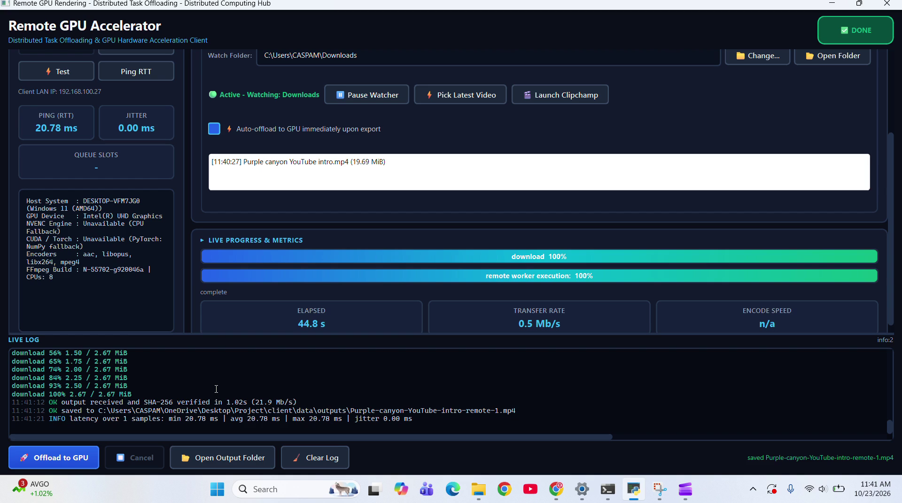
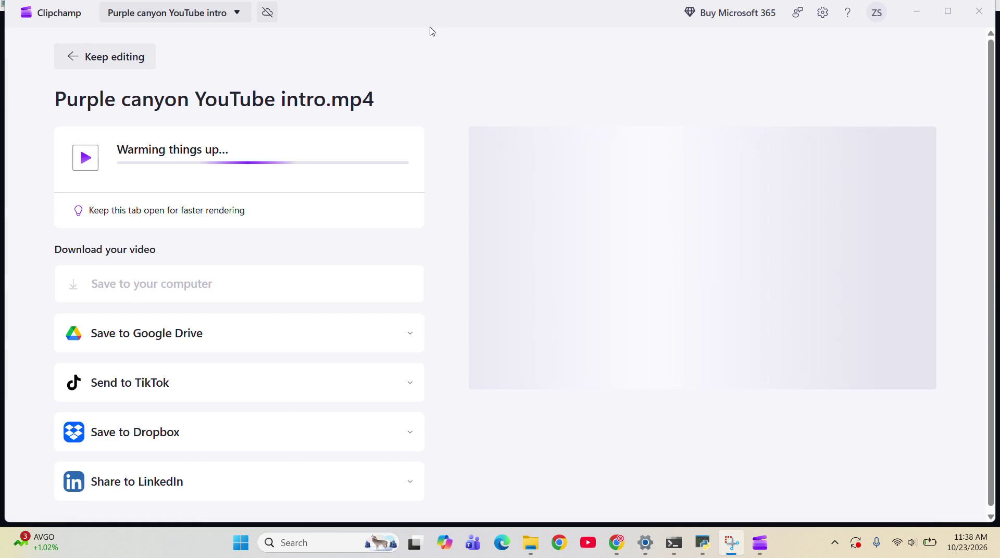
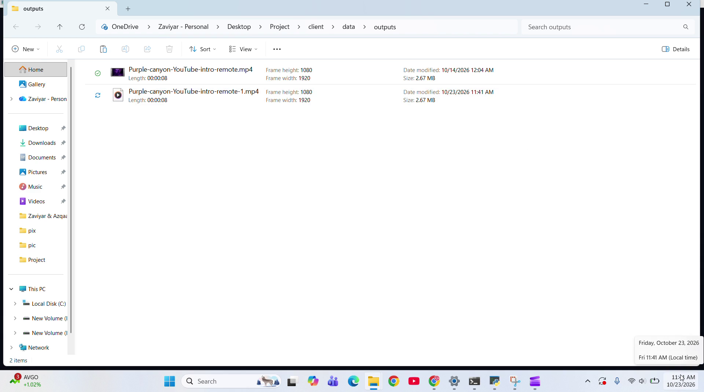

# Screenshots & Visual Walkthrough

Captured directly from the live multi-machine screen recordings on Windows 11 across two network nodes (`192.168.100.27` client laptop and `192.168.100.3` worker desktop).

The suite captures the complete lifecycle of remote execution—from server daemon discovery, client capability negotiation, active Clipchamp export detection, dual streaming progress, to SHA-256 verified download and local output delivery.

---

## Gallery Index

| State | Preview File | Description |
|---|---|---|
| **01. Worker Daemon** | [`01-startup-server.png`](01-startup-server.png) | Worker Node GUI listening on `192.168.100.3:7575` with active client tracking and hardware detection |
| **02. Connected Client** | [`02-connected-capabilities.png`](02-connected-capabilities.png) | Modern PyQt6 client connected, latency probed (26.62 ms), Clipchamp watch folder active |
| **03. Job In Progress** | [`03-job-running.png`](03-job-running.png) | Live dual-stream progress: 100% upload, active remote execution at 95%, 19.6 Mb/s transfer rate |
| **04. Job Complete** | [`04-job-complete.png`](04-job-complete.png) | 100% download received, SHA-256 verified in 1.02s, 19.69 MiB compressed to 2.67 MiB (86.4% reduction) |
| **05. Clipchamp Export** | [`05-clipchamp-export.png`](05-clipchamp-export.png) | User editing & exporting *"Purple canyon YouTube intro"* in Microsoft Clipchamp |
| **06. Verified Output** | [`06-output-verified.png`](06-output-verified.png) | Windows File Explorer displaying final rendered 1080p MP4 ready for playback |

---

## 1. Worker Daemon Initialized & Listening
Worker daemon running in GUI mode on `0.0.0.0:7575` (Primary LAN IP `192.168.100.3`). Hardware probes detect Intel(R) UHD Graphics, 8 CPU cores, FFmpeg build capabilities, and authorized subnets. The active client table tracks connection from `192.168.100.27:54778`.

---

## 2. Client GUI, Watch Folder & Capability Negotiation
The client interface connected to worker `192.168.100.3:7575`, performing handshake negotiation to fetch remote hardware profiles. Network ping (26.62 ms) and jitter (0.00 ms) are monitored in real time, and the background Folder Watcher monitors `C:\Users\CASPAM\Downloads` with auto-offload armed.

---

## 3. Active Offload & Live Progress Streaming
During active transcoding, the client tracks both transmission and execution concurrently. Monotonic progress updates stream back from the daemon: upload completed at 19.6 Mb/s, and remote worker execution is actively tracked at 95% with frame-level telemetry.

---

## 4. Completed Job & SHA-256 Verification
Once remote rendering finishes, framed chunks stream back to the client at 21.9 Mb/s. The client computes an end-to-end SHA-256 checksum to ensure byte-perfect fidelity in 1.02s, updates the status to Done, and saves the optimized output (2.67 MiB, down from 19.69 MiB).

---

## 5. Microsoft Clipchamp Video Editing & Export Workflow
The user cuts clips, arranges text, and triggers export for *"Purple canyon YouTube intro"* in Microsoft Clipchamp on the client laptop. The draft export is automatically picked up by the client watcher upon write completion.

---

## 6. Local Output Verification in Windows File Explorer
The client automatically delivers the rendered master video into the local outputs directory (`outputs/Purple-canyon-YouTube-intro-remote-1.mp4`, 1920x1080, 2.67 MB) ready for playback and distribution.

